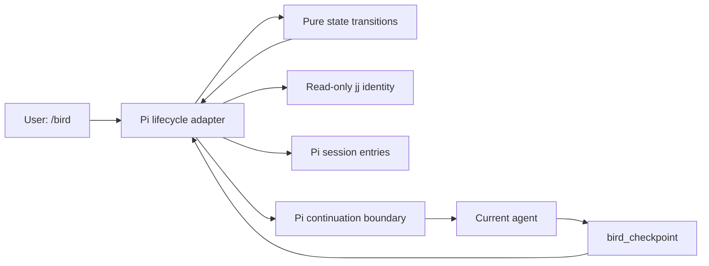

# Dipping Bird architecture

## Purpose and boundaries

Bird requests additional work in the current Pi session after a user explicitly
starts supervision. It does not run another agent, execute task tools, verify
acceptance evidence, or authorize operations. The user reviews completion.

## Components

- `extensions/core.ts` owns immutable state transitions, input bounds, prompt
  text, budget checks, and parsing persisted state.
- `extensions/index.ts` coordinates modes, `/bird`, `bird_checkpoint`, and Pi
  lifecycle handlers. Its revision counter discards stale identity results.
- `extensions/bird-control.ts` exposes model-only supervision controls without
  changing the saved pin or renewing budgets.
- `extensions/nag.ts` owns reminder commands, tools, and delivery priority;
  `nag-state.ts` owns pure transitions, and `nag-marker.ts` writes sidecars.
- Pi owns message scheduling, tool permissions, model calls, and persistence.
  The manifest exposes only `extensions/index.ts` as an extension entry point.

## State and lifecycle

The `dipping-bird-v1` custom entry contains the goal, canonical directory, jj
change pin, original start time, continuation count, checkpoint, and mode.
Restoration reads only the active session branch and always yields paused state.
Malformed latest state clears earlier state rather than falling back to an older
armed window. Checkpoints are session data, not independent proof.

A start queues a nonce-bearing user prompt while Bird remains paused. Only the
exact prompt with a verified pin and remaining budget can arm at `agent_start`.
Stop, lifecycle replacement, and final settlement invalidate pending lookups.
`dipping-bird-start-v1` entries record each exact issued prompt and its consumption.
The active branch retains these receipts across extension reloads, unlike a
factory-local set. A receipt can reject a delayed prompt but cannot arm Bird.
Once consumed, it no longer claims a later manual copy of that prompt.
`agent_before_settle` appends its proposal after earlier extensions' entries;
it does not duplicate work when another continuation or message is pending.

`running`, `paused`, `blocked`, and `review` are the persisted modes. `review`
means completion reported. Blocked, paused, and review states cannot re-arm within
the same run. After fresh user input, the agent may resume remaining limits;
only a user command can create a new window. Compaction keeps the current window;
reload and tree navigation do not re-arm it.

Nag is a separate, uncapped session state. It proposes one native continuation
at `agent_before_settle`, not a nested run from notification-only settlement.
It yields there and again in `context` to native queues and synchronous
`bird:yield-to-input` claims. Queued
notices contain no prompt; the current prompt is projected only at delivery.
Historical notices are filtered from subsequent context, so suppressed prompts
never enter compaction. A canceled notice instructs one turn to take no action;
its assistant tool calls are suppressed. The projection count increments once
per notice, with optional timestamp/path/entry-ID correlation in a sidecar. This
is not proof of provider delivery. Both model tools honor explicit stops and
require delivery of matching fresh human input to re-arm after a stop. Submitted,
rejected, or locally handled input doesn't unlock an old tool batch. Nag restores
off after resource recovery or branch navigation, retaining its prompt/count.

## Operation

See [the README](README.md#limits-and-safety) for limits and operator commands.
Identity lookup fails closed on timeout, process failure, malformed output, or
pin drift. Elapsed limits are checked between runs and again when queued initial
work arms, not by an interrupting timer. Bird cannot preempt an in-flight tool
when its elapsed cap expires.

Builds ship TypeScript source. Pi supplies the peer imports. The package smoke
check installs the real tarball without peers or development dependencies and
loads it with the pinned SDK in an isolated agent directory. CI uses the same
validation recipes as local development. CI results and live protection must
be observed separately from the configuration committed here.
